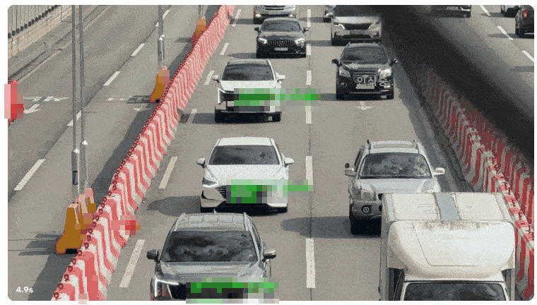
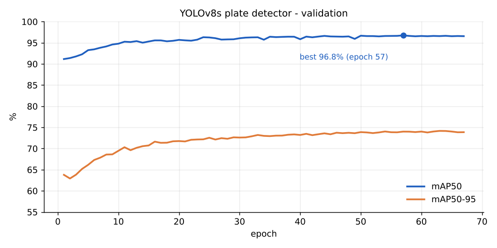
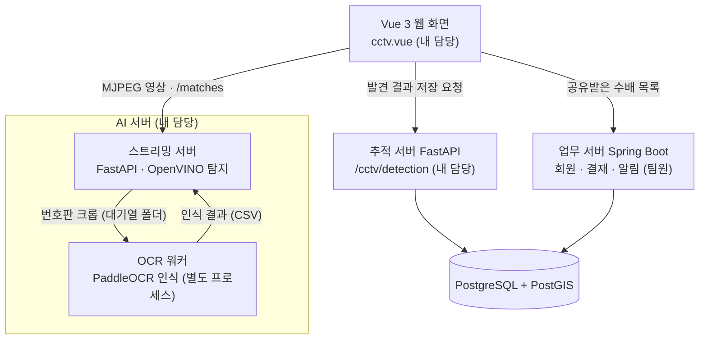

# V-TRAIL 번호판 인식 · CCTV 실시간 탐지

CCTV 영상에서 번호판을 찾아 읽고, 수배차량이면 관측 기록과 알림으로 연결하는 기능입니다.
**V-TRAIL 수배차량 통합 관제 시스템** 팀 프로젝트에서 제가 맡은 부분만 모은 저장소입니다.



> 공개용으로 화면 속 번호판과 인식 결과 글자는 흐리게 처리했습니다. 빨간 박스가 수배차량으로 확정된 차량입니다.

## 프로젝트 정보

| 항목 | 내용 |
| --- | --- |
| 프로젝트 | V-TRAIL 수배차량 통합 관제 시스템 (에스트래픽 풀스택 과정 팀 프로젝트) |
| 기간 | 2026.09.02 ~ 2026.10.07 (1차), 2차 개발 진행 중 |
| 인원 | 6명 |
| 내 담당 | 번호판 탐지 · 인식 AI 서버 전체, CCTV 실시간 탐지 화면과 발견 기록 저장 API |
| 팀 저장소 | [KJBU011/V-Trail](https://github.com/KJBU011/V-Trail) (비공개) |

## 결과

| 항목 | 결과 |
| --- | --- |
| 번호판 탐지 (YOLOv8s) | mAP50 **96.8%**, Precision 96.8%, Recall 94.0% |
| 번호판 인식 (PaddleOCR) | 번호판 전체 문자열 일치 **91.7%**, 문자 단위 유사도 98.2% |
| CPU 추론 속도 | OCR 1장 약 900ms → **약 20ms**, 탐지 1회 약 70ms → **약 32ms** |
| 오인식 줄이기 | 신뢰도 0.9 이상인 오답 74개 → **23개** (CCTV 영상 2개 평가) |



## 시스템 구조



- AI 서버는 탐지와 인식만 하고 DB에는 쓰지 않습니다. 저장은 추적 서버가 맡아서, AI 서버를 다른 PC로 옮겨도 DB 설정이 필요 없습니다.
- PyTorch(탐지)와 Paddle(인식)은 CUDA DLL 이름이 겹쳐 한 프로세스에서 같이 쓸 수 없어서, 두 프로세스로 나누고 폴더를 작업 대기열로 연결했습니다.

## 저장소 구성

```
vtrail-license-plate/
├── ocr_server/                     # 번호판 탐지 · 인식 AI 서버
│   ├── scripts/
│   │   ├── detect_stage.py         # 번호판 탐지 (YOLOv8s, 여러 크기 추론)
│   │   ├── recognize_stage_nrtr.py # 번호판 인식 (PaddleOCR CTC/NRTR, CPU 추론 엔진)
│   │   ├── export_ctc_infer.py     # 학습 모델 → CPU 추론용 모델 변환
│   │   ├── live_stream_server.py   # CCTV 스트리밍 · 탐지 · 발견 확정 (FastAPI, :8010)
│   │   └── live_ocr_worker.py      # 실시간 OCR 워커 (별도 프로세스)
│   ├── configs/plate_ocr_v5.yml    # 인식 모델 학습 설정
│   ├── datasets/plate_ocr/plate_dict.txt
│   ├── requirements/               # torch용 · paddle용 가상환경 분리 (GPU / CPU)
│   └── train_results/              # 탐지 모델 학습 설정 · 에폭별 결과
├── cctv_integration/               # 웹 연동
│   ├── client/components/cctv.vue  # CCTV 실시간 탐지 화면
│   └── fa_server/                  # 발견 기록 저장 · 알림 API (router / service / repository)
└── docs/                           # 시연 GIF, 학습 곡선
```

## 번호판 인식 파이프라인

1. **관심 영역(ROI)**: 도로 원근에 맞춘 사다리꼴 영역 안의 번호판만 처리합니다.
2. **번호판 탐지**: YOLOv8s를 원거리 CCTV에 맞춰 `imgsz=1280`으로 파인튜닝했습니다.
3. **크롭 · 보정**: 여백을 두고 잘라낸 뒤 작은 번호판은 확대하고, 좌우에 20px 여백을 붙입니다.
4. **문자 인식**: PaddleOCR PP-OCRv5 한국어 모델을 CTC + NRTR 두 헤드로 파인튜닝했습니다. 실시간 추론은 속도 때문에 CTC 헤드만 씁니다.
5. **검증 · 확정**: 번호판 형식 정규식을 통과하고, 같은 차량을 최근 3번 중 2번 같게 읽어야 발견으로 확정합니다.

## API

| 서버 | Method | Endpoint | 설명 |
| --- | --- | --- | --- |
| AI 서버 | GET | `/stream` | 탐지 박스를 그린 CCTV 영상을 MJPEG로 송출 (카메라 · 대조 목록 · 세션 지정) |
| AI 서버 | GET | `/matches` | 세션별 발견 차량 목록 (화면이 1초마다 조회) |
| AI 서버 | GET | `/control` | 재생 조작: 일시정지 · 재개 · 앞뒤 이동 |
| 추적 서버 | POST | `/cctv/detection` | 발견 결과 저장: 관측 기록 + 담당자 · 공유 팀원 알림을 한 트랜잭션으로 |

- 재생마다 세션 ID를 발급해, 카메라 2대를 동시에 재생해도 결과가 섞이지 않습니다.
- 발견마다 `detection_id`를 붙여 화면이 같은 발견을 두 번 저장하지 않고, 서버는 같은 차량을 10분 안에 다시 기록하지 않습니다.

## 트러블슈팅

### ① 묶음 처리 중 결과가 통째로 사라짐
- **문제**: OCR을 여러 장씩 묶어 한 번에 처리하는데, 가끔 한 묶음의 인식 결과가 전부 사라졌습니다.
- **원인**: 화면 가장자리에 걸려 얇게 잘린 번호판은 전처리 후 폭이 달라집니다. 폭이 다른 이미지를 한 묶음으로 쌓으면 에러가 나서, 함께 묶인 정상 번호판까지 같이 버려졌습니다.
- **해결**: 같은 크기의 이미지끼리 따로 묶어 처리하고, 원래 순서 번호로 결과를 다시 맞췄습니다. (`recognize_stage_nrtr.py`의 `recognize_batch`)

### ② GPU 없이 CPU에서 실시간 처리
- **문제**: GPU 서버에 원격 접속하던 구조를 각자 PC의 CPU로 옮기자, 번호판 1장 인식에 약 0.9초가 걸려 영상을 따라가지 못했습니다.
- **원인**: 학습용 체크포인트를 그대로 실행했고, 글자를 한 자씩 생성하는 NRTR 헤드가 CPU에서 특히 느렸습니다.
- **해결**: OCR은 정적 추론 모델 + oneDNN으로 변환하고 CTC 헤드만 남겼습니다. 변환 전후 출력 차이를 비교해 결과가 같은지 확인했습니다. 탐지는 OpenVINO로 변환하고(입력 512×960 고정), 영상 루프와 분리된 스레드에서 실행했습니다.
- **결과**: OCR 1장 약 900ms → 약 20ms, 탐지 1회 약 70ms → 약 32ms

### ③ 틀렸는데 확신하는 결과 줄이기
- **문제**: 한 글자 오인식(3↔8, 보↔부)이 우연히 수배 번호와 같아지면 잘못된 알림이 갑니다. 그런데 틀린 결과도 신뢰도 0.9 이상으로 표시됐습니다.
- **원인**: 신뢰도를 글자별 점수의 평균으로 계산해서, 한 글자만 헷갈려도 전체 점수가 높게 유지됐습니다.
- **해결**: 신뢰도를 글자별 점수의 최솟값으로 바꾸고, 번호판 형식 검사와 "3번 중 2번 일치" 확정 조건을 추가했습니다.
- **결과**: 신뢰도 0.9 이상인 오답 74개 → 23개

### ④ 가까이 찍힌 번호판 탐지 실패
- **문제**: 원거리 CCTV 기준으로 학습한 탐지 모델이 가까이서 크게 찍힌 번호판을 전혀 찾지 못했습니다.
- **원인**: 학습 데이터가 전부 작은 번호판이라, 큰 물체를 담당하는 탐지 레이어가 거의 학습되지 않았습니다.
- **해결**: 재학습 없이 한 이미지를 여러 크기(1280 · 640 · 480 · 384 · 320)로 나눠 추론하고, 크기 간 중복 박스는 IoU로 제거했습니다.
- **결과**: 근거리 실사진 300장 탐지율 98.3%

### ⑤ 번호판 맨 앞 숫자 누락
- **문제**: "123가4567"을 "23가4567"처럼 맨 앞 숫자를 빼먹고 읽는 경우가 반복됐습니다.
- **원인**: 탐지 박스가 번호판에 딱 맞게 잘려, 맨 앞 글자가 이미지 가장자리에 붙어 있으면 모델이 놓쳤습니다.
- **해결**: 인식 직전에 좌우 20px 여백을 붙이고(가장자리 픽셀 복제), 폭 120px 미만인 크롭은 확대했습니다.
- **결과**: 앞자리 누락 26번 → 5번, 최종 확정 오답 차량 1대 → 0대

## 실행 방법

> 학습된 모델 가중치, CCTV 영상, 학습 데이터는 용량과 개인정보 문제로 저장소에 포함하지 않았습니다.

PyTorch와 Paddle은 같은 환경에 설치하면 충돌하므로 가상환경을 두 개 만듭니다.

```powershell
cd ocr_server
# 1) 탐지·스트리밍 서버용 (torch)
py -3.11 -m venv venv
.\venv\Scripts\pip install -r requirements\requirements_venv_torch_cpu.txt
# 2) OCR 워커용 (paddle) — 스트리밍 서버가 이 환경으로 워커를 자동 실행합니다
py -3.11 -m venv ocr_env
.\ocr_env\Scripts\pip install -r requirements\requirements_ocr_env_paddle_cpu.txt
git clone https://github.com/PaddlePaddle/PaddleOCR.git

# 실행 (워커도 함께 켜짐)
.\venv\Scripts\python scripts\live_stream_server.py
```

필요한 파일 위치

- 탐지 모델: `runs/detect/plate_detector_v8s-2/weights/best.pt` (OpenVINO 변환본은 같은 폴더의 `best_openvino_model/`)
- 인식 모델: `output/plate_rec_v5/best_accuracy.*` → `scripts/export_ctc_infer.py`로 `output/plate_rec_v5_infer/` 생성
- CCTV 영상: `output/video_watch/`

추적 서버(FastAPI)의 DB 접속 정보는 환경변수로 설정합니다: `DB_HOST`, `DB_PORT`, `DB_NAME`, `DB_USER`, `DB_PASSWORD`

## 기술 스택

- **AI · Vision**: Python 3.11, YOLOv8s (Ultralytics), PaddleOCR PP-OCRv5, OpenVINO, OpenCV
- **Backend**: FastAPI, PostgreSQL (psycopg2)
- **Frontend**: Vue 3, Axios
